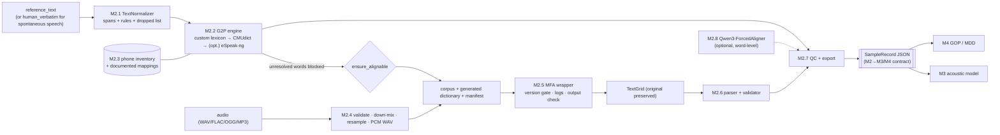

# ASA M2 — Phonetic Front-end

Research-grade Python package for **Module M2** of an Automated Speaking Assessment (ASA) system for English L2 learners.
M2 turns *text + audio* into **canonical phonetic representations, pronunciation dictionaries and forced-alignment target intervals**
that modules M3 (acoustic modelling) and M4 (mispronunciation detection) consume through a versioned data contract.

> **Status of verification** (details in [Build status](#21-build-status-and-what-is-not-verified)): 552 automated tests pass on Python 3.12.3 (543 unit + 9 integration; 2 live-integration modules skipped);
> real eSpeak-ng was exercised. **Real Montreal Forced Aligner and Qwen3-ForcedAligner could not be run in the build environment**, so the
> MFA wrapper is verified against the MFA 3.4.3 *source* and a *fake* `mfa` executable, and the Qwen adapter is unverified live.

---

## Contents
1. [Project overview](#1-project-overview) · 2. [Scope and non-goals](#2-m2-scope-and-non-goals) · 3. [Architecture](#3-architecture) ·
4. [Install (Ubuntu)](#4-installation-on-ubuntu) · 5. [Install (Windows)](#5-installation-on-windows) · 6. [CUDA / RTX 4090](#6-cuda--rtx-4090-considerations) ·
7. [eSpeak-ng](#7-espeak-ng-setup) · 8. [MFA](#8-montreal-forced-aligner-installation-and-supported-versions) · 9. [G2P](#9-g2p-usage) · 10. [Phone inventory](#10-phone-inventory) ·
11. [Corpus preparation](#11-corpus-preparation) · 12. [Forced alignment](#12-forced-alignment) · 13. [TextGrid inspection](#13-textgrid-inspection) · 14. [JSON schema](#14-json-output-schema) ·
15. [M3](#15-m3-integration) · 16. [M4](#16-m4-integration) · 17. [Tests](#17-running-tests) · 18. [Troubleshooting](#18-troubleshooting) · 19. [Limitations](#19-limitations) ·
20. [Reproducibility](#20-reproducibility-and-versioning) · 21. [Build status](#21-build-status-and-what-is-not-verified)

## 1. Project overview

| Component | What it does |
|---|---|
| **M2.1 Text normalisation** | Auditable tokenisation of English text. Every normalised token is traceable to its original character span; nothing is silently deleted. |
| **M2.2 G2P** | CMUdict (primary) → optional eSpeak-ng fallback; custom lexicon; all pronunciation variants kept; ARPABET stress preserved; OOV words explicit. |
| **M2.3 Phone inventory** | Versioned ARPABET inventory (39 phones, stable IDs), IPA display labels, documented mappings, strict validation. |
| **M2.4 Corpus preparation** | Audio validation, down-mix, real resampling, PCM-WAV export, MFA corpus + dictionary, reproducible manifest. |
| **M2.5 MFA wrapper** | Version-gated subprocess wrapper (verified against MFA 3.4.3 CLI source) with log capture and output verification. |
| **M2.6 TextGrid parser** | Reads long/short TextGrids, reports invalid/overlapping intervals instead of crashing, configurable tier selection. |
| **M2.7 Alignment QC** | OOV/missing-word/missing-phone/unexpected-label/duration indicators; boundary evaluation against gold alignments. |
| **M2.8 Qwen adapter** | *Optional*, lazy, word-level only; live integration unverified. |

## 2. M2 scope and non-goals

**Inputs.** English `reference_text` (what the learner was *expected* to say) and audio. Optionally an anonymised `speaker_id`, and a `human_verbatim`
transcript (what the learner *actually said*). The two text fields are never interchangeable: read-aloud assessment needs `reference_text` for canonical G2P and
alignment; for spontaneous speech G2P may run on a human-verified verbatim transcript, which is *not* a reference answer for the task.

**M2 provides:** canonical phone sequences · pronunciation variants · phone IDs · word/phone *target* intervals · alignment quality indicators · provenance.

**M2 does NOT provide** (belongs to M3/M4/M5/M6): realised-phone recognition · GOP · mispronunciation labels · pronunciation or fluency scores · MDD confidence · feedback.
This is enforced in code: `PhoneAlignment.realized_phone` is validator-locked to `None`, and the output schema rejects unknown fields (a test asserts that no GOP/MDD
concepts appear in the schema).

No personally identifying learner data is requested or accepted: manifests containing columns such as `name`, `student_id`, `address`, `email` are **rejected**.

## 3. Architecture



More detail: [docs/architecture.md](docs/architecture.md).

## 4. Installation on Ubuntu

Tested: Ubuntu 24.04, Python 3.12.3. The declared range is Python ≥ 3.10 (syntax is 3.10-compatible) but **only 3.12 was tested**.

```bash
sudo apt-get update && sudo apt-get install -y python3-venv libsndfile1   # libsndfile is bundled in the soundfile wheel; installed here for safety
python3 -m venv .venv && . .venv/bin/activate
pip install -r requirements.txt          # exact tested versions
pip install -e . --no-deps               # or: pip install -e ".[dev]"
asa-m2 check                             # verifies dependencies, config, inventory, optional components
```

Core M2 needs **no GPU, no network access at run time** and no model downloads (CMUdict data ships inside the `cmudict` package).

## 5. Installation on Windows

Not tested in the build environment. Expected to work for core M2 (all Python dependencies publish Windows wheels):

```powershell
py -3.12 -m venv .venv ; .\.venv\Scripts\Activate.ps1
pip install -r requirements.txt ; pip install -e . --no-deps
asa-m2 check
```

eSpeak-ng and MFA on Windows are third-party installs (see their own documentation). MFA is distributed via conda-forge on Windows too. **Unverified here.**

## 6. CUDA / RTX 4090 considerations

* **Core M2 does not use the GPU.** Normalisation, G2P, audio preparation, TextGrid parsing and QC are CPU-only.
* **MFA alignment is CPU-only in the inspected release.** In the MFA 3.4.3 source, CUDA options exist only for diarisation / transcription / segmentation commands; the
  `align` and `align_hf` commands have no GPU option. An RTX 4090 therefore does **not** speed up M2's primary alignment path.
* **Only the optional Qwen3-ForcedAligner adapter can use a GPU.** Install a CUDA-enabled PyTorch build for your driver following PyTorch's own instructions, then
  `pip install qwen-asr`. The adapter defaults to `device: auto` (→ `cuda:0` if available, otherwise CPU with a warning) and `dtype: bfloat16`; the 4090 (Ada) supports bf16.
  The model is small (0.6 B parameters per its name), so 24 GB should be ample, but **memory use and speed were not measured here**. CUDA OOM and download errors are translated into
  an explicit `QwenResourceError` (exit code 7). Set `alignment.qwen.device: cpu` and `dtype: float32` to force CPU.

## 7. eSpeak-ng setup

eSpeak-ng is **optional** and used **only** when you opt in (`--fallback espeak` or `g2p.fallback_backend: espeak`) for words missing from CMUdict.

```bash
sudo apt-get install -y espeak-ng        # tested with 1.51 (Ubuntu 24.04 package)
asa-m2 check --require espeak-ng         # exit code 5 if unavailable
asa-m2 g2p --text "the blorptastic cat" --fallback espeak
```

Output is mapped to ARPABET **only** through the documented `espeak_en_us_ipa` table in `configs/phoneme_mapping.json`. Units that cannot be mapped without guessing
(alveolar flap `ɾ`, glottal stop `ʔ`, `x`, `ɬ`, trilled `r`) make the word **unresolved with an explicit reason**; they are never dropped or approximated silently.
Measured on a fresh random sample of 1,500 CMUdict words: 1,383 resolved (92.2 %), 117 unresolved by design (7.8 %), **0** unexpected units
(`tests/integration/test_espeak_live.py`). Fallback pronunciations are flagged `fallback_pronunciation` and are lower-confidence than CMUdict.

## 8. Montreal Forced Aligner: installation and supported versions

MFA is installed through **conda-forge** (its Kaldi/Pynini dependencies come from conda; official instruction:
`conda install -c conda-forge montreal-forced-aligner`, see <https://montreal-forced-aligner.readthedocs.io/> and the
[PyPI project page](https://pypi.org/project/montreal-forced-aligner/)). **`pip install montreal-forced-aligner` alone is not enough** —
we observed in the build environment that it installs 3.4.3 but `mfa version` then fails with `ModuleNotFoundError: No module named '_kalpy'`; `asa-m2 check` reports this clearly.

```bash
conda create -n aligner -c conda-forge montreal-forced-aligner     # not executed in the build environment
conda activate aligner
mfa version                                                        # must print a supported version
mfa model download acoustic english_us_arpa                        # `model download` verified in 3.4.3 source; model name is MFA's, not verified here
pip install -r requirements.txt && pip install -e . --no-deps      # install asa-m2 into the SAME environment, or keep it separate and put `mfa` on PATH
asa-m2 check --require mfa
```

**Supported versions.** CLI syntax was verified by reading the **MFA 3.4.3** command-line source. `asa-m2` accepts `3.4.3` silently, other `3.4.x` with a warning
(patch version not inspected) and **refuses everything else** with a clear error (override at your own risk with `--allow-unverified-mfa`). Verified surface:

| Command | Notes |
|---|---|
| `mfa version` | parsed for `major.minor.patch` |
| `mfa align CORPUS DICTIONARY ACOUSTIC_MODEL OUTPUT` | legacy acoustic models. Options used: `--output_format {long_textgrid,short_textgrid}`, `--clean`, `--overwrite/--no_overwrite`, `--num_jobs`, `--temporary_directory`, `--single_speaker`, `--textgrid_cleanup/--no_textgrid_cleanup`, `--ignore_oovs`, `--fine_tune`, pass-through `--beam`, `--retry_beam` |
| `mfa align_hf CORPUS MODEL_ID OUTPUT` | Hugging Face model format. Options: `--dialect`, `--use_g2p`, `--fine_tune` + the common ones above (`--ignore_oovs` is **not** an `align_hf` option and is rejected) |
| `mfa validate CORPUS DICTIONARY [--acoustic_model_path M]` | optional pre-check (`--mfa-validate`) |
| env `MFA_ROOT_DIR` | passed through when `alignment.mfa.mfa_root_dir` is set |

Corpus conventions confirmed in the source: transcripts are `.lab` (preferred) or `.txt` beside the audio; the *folder name is the speaker*; TextGrid tiers are named
`words`/`phones`, or `<speaker> - words` when a file holds several speakers; silence is an empty label (`sil`/`<eps>` possible), OOV is `spn` (phone) / `<unk>` (word).
Dictionaries from `english_us_arpa` (v2.0.0, inspected) use ARPABET **with stress digits**, which is why generated dictionaries keep stress by default.
Model identifiers are never hard-coded: set `alignment.mfa.acoustic_model` (name or path) yourself.

## 9. G2P usage

```bash
asa-m2 g2p --text "I think this is important."
asa-m2 g2p --text "I think this is important." --json
asa-m2 g2p --input examples/sample_reference.txt --output phones.json
asa-m2 g2p --text "the blorptastic cat" --lexicon examples/custom_lexicon.dict
asa-m2 g2p --text "the blorptastic cat" --fallback espeak
asa-m2 g2p --text "uh well I went" --text-field human_verbatim
```

Example (real output; `this` and `the` have several CMUdict variants and **none is silently chosen**):

```text
text:       I think this is important.
normalized: i think this is important
  [0] i      AY1                       (cmudict; sole_variant: cmudict:i:1)
  [1] think  TH IH1 NG K               (cmudict; sole_variant: cmudict:think:1)
  [2] this   DH IH1 S | DH IH0 S       (cmudict; unselected: none selected)
```

* **Variants.** `g2p.variant_policy: keep_all` (default) keeps every variant and selects none when several exist. `first_listed` is an explicit, flagged opt-in.
  A custom-lexicon line `!select <word> <n>` is a documented manual override. After alignment, the aligner's own phone choice may resolve a variant
  (`selection_method: alignment_match`) — this records *the aligner's choice among candidates*, **not** what the learner said.
* **OOV.** Words absent from every source are `unresolved`, `approved_for_alignment: false`, and block corpus preparation (`g2p.fail_on_unresolved_oov: true`, exit code 4) unless you add a lexicon entry,
  enable the eSpeak fallback, or choose to exclude such samples (`false`).
* **Custom lexicon** (`examples/custom_lexicon.dict`): ARPABET with stress digits, one line per variant; `--lexicon-mode override|augment`; errors report file and line number.
* **Stress** is parsed off the symbol (`AY1` → base `AY`, stress `1`) and the raw symbol is preserved.
* **Numbers** are expanded with *one* reading (`21` → "twenty one"); ambiguous ones (e.g. `1999`) raise a warning. Prefer spelled-out numbers in read-aloud reference text.
  `3D`, URLs, `$`, emoji, dotted acronyms stay in the stream flagged `unsupported_token` (unresolved).

## 10. Phone inventory

`configs/phoneme_inventory.json`, `phone_to_id.json`, `id_to_phone.json`, `phoneme_mapping.json` (versioned: `asa-arpabet-cmu39` v1.0.0).

* 39 CMUdict ARPABET base phones, **stable IDs 1–39** (alphabetical; append-only evolution). IPA is *display only*; ARPABET and IPA are never interchangeable (an IPA symbol is rejected where ARPABET is expected).
* Vowel/consonant category and articulatory metadata (height/backness/rounding/diphthong/rhotic; place/manner/voicing) — a convenience, not an authoritative linguistic claim.
* **Stress is separate** from phone identity (values 0/1/2, vowels only).
* **CTC blank** = reserved ID 0 *by convention*; it is **not a phoneme and not silence**, and appears in neither `phone_to_id` nor `id_to_phone`. **No silence class is invented**; aligner silence labels are kept as label *roles* in alignment output.
* Unknown phones, IDs or mappings raise; nothing is silently remapped.

```bash
python scripts/validate_inventory.py                              # validates all four files + mappings
python scripts/validate_inventory.py --acoustic-phones my_model_phones.txt   # compatibility with a model's phone set
```

M3's acoustic model may use a different phone set; compatibility is *checked* (`check_compatibility`, `validate-corpus --acoustic-phones`), never assumed.
Obtain a model's phone list e.g. with `mfa model inspect acoustic <model>` (command present in the 3.4.3 source; output format not verified here).

## 11. Corpus preparation

Manifest (`examples/input_manifest.csv`): required `sample_id`, `audio_path`; text via `reference_text` and/or `reference_path` and/or `human_verbatim`; optional `speaker_id`.

```bash
python examples/make_example_audio.py            # SYNTHETIC tones (not speech) just to exercise the plumbing
asa-m2 prepare-corpus --manifest examples/input_manifest.csv --output data/processed/corpus
asa-m2 validate-corpus --corpus data/processed/corpus
```

* Audio: validated (existence, readability incl. **truncated-WAV detection**, duration, sample rate, NaN, digital silence, clipping warning); stereo → mono (`audio.stereo_to_mono`: `mean|left|right|reject`);
  **real polyphase resampling** (`scipy.signal.resample_poly`; sample-rate metadata is never changed without resampling); PCM WAV export; `audio.target_sample_rate` is configurable (16 kHz default — set it from your acoustic model's requirements, not by assumption).
  Originals are only read, never modified; every transformation and SHA-256 is recorded in `corpus_manifest.json`.
* Speakers: unknown speaker → **unique deterministic pseudo-ID per recording** (`SPK_UNK_<hash>`); unrelated recordings are never grouped. Policies: `speaker.missing_id_policy: unique_per_recording | error | shared`, `speaker.grouping: by_speaker_id | per_recording`.
  Risks of wrong grouping: [docs/research_limitations.md](docs/research_limitations.md#speaker-grouping).
* Safety: identifiers must match `[A-Za-z0-9][A-Za-z0-9_.-]*` (no separators, no `..`); outputs are checked against the output root and against source files; existing outputs require `--overwrite`; PII-style columns are rejected.
* Output layout: `mfa_corpus/<speaker>/<id>.{wav,lab}`, `dictionary/asa_m2_corpus.dict`, `g2p/<id>.g2p.json`, `corpus_manifest.json`.

## 12. Forced alignment

```bash
asa-m2 align-mfa --corpus data/processed/corpus --output data/outputs/alignment \
    --acoustic-model english_us_arpa          # or set alignment.mfa.acoustic_model in a YAML config
```

Pipeline: validate corpus → check MFA installation/version → (optional `mfa validate`) → `mfa align` → verify every expected TextGrid exists → parse/validate → write `json/<id>.json`, `alignment_summary.json`, and `logs/` (stdout, stderr, exact command + MFA config; never overwritten).

* Non-zero MFA exit → `MFACommandError` (exit 5). **Exit 0 with missing TextGrids is *not* success** (reported per sample, exit 6).
* The exact command line (with absolute paths) is kept only in the local `logs/*.command.json`; shared JSON records carry a sanitized form (`<corpus>`, `<dictionary>`, `<output>`), so no home-directory or user names leak.
* A sample is `success` only if its TextGrid exists, parses, and has no error-level flag. **`success` does not mean the learner pronounced the targets correctly.**
* Hugging Face models: `--mode hf --hf-model-id <id>` runs `mfa align_hf`. Dictionary: generated by default; `--dictionary <name|path>` to use another.
* Optional word-level alternative: `asa-m2 align-qwen --audio a.wav --text "..." --output rec.json` (see [Qwen](docs/architecture.md#qwen3-forcedaligner-adapter-optional); granularity **word** only; live use unverified).

## 13. TextGrid inspection

```bash
asa-m2 inspect-textgrid --input sample.TextGrid                  # tiers, intervals, validation issues (exit 6 on errors)
asa-m2 inspect-textgrid --input sample.TextGrid --json
asa-m2 export --textgrid sample.TextGrid --output sample.json    # alignment-only export
asa-m2 export --textgrid sample.TextGrid --text "I think this is important." --sample-id S001 \
    --aligner-name MFA --aligner-version 3.4.3 --output sample_record.json
asa-m2 evaluate-boundaries --pred pred_textgrids/ --gold gold_textgrids/ --tier phone --tolerance 0.02
```

Tier names are **not assumed**: `alignment.textgrid.word_tier_names/phone_tier_names` are configurable, `<speaker> - words` is accepted when unambiguous, and `--word-tier/--phone-tier` select explicitly.
Detected and reported (never repaired): negative / zero duration, negative start, overlaps, unsorted intervals, gaps, tier-range problems, TextGrid-vs-audio duration mismatch (with a milliseconds-vs-seconds hint), empty/malformed files.
Invalid intervals are *excluded from the JSON and flagged as errors*; no timestamp is ever invented. Duration thresholds (`alignment.qc.*`) are **alignment sanity warnings, not pronunciation-error thresholds**.
Boundary evaluation reports MAE, median absolute error, % within tolerance and failure rate **only against annotations you supply**; no claim is made that alignment quality on HANU or L2-ARCTIC has been validated.

## 14. JSON output schema

`SampleRecord` (schema `1.0`) — machine-readable: [docs/schema/sample_record.schema.json](docs/schema/sample_record.schema.json) (also `examples/expected_output_schema.json`); explanation: [docs/data_contract.md](docs/data_contract.md); G2P-only example: `examples/example_g2p_output.json`.

```json
{
  "schema_version": "1.0",
  "sample_id": "S001",
  "speaker_id": "SPK_001",
  "reference_text": "I think this is important.",
  "human_verbatim": null,
  "g2p_input_field": "reference_text",
  "tokens": ["... TokenRecord: original/normalized token, span, variants, selection_method, source, resolution_status ..."],
  "canonical_phones": ["... only for words with a selected variant: base_phone, phone_id, stress, variant_id ..."],
  "word_alignments": ["... label, word_index, label_role, start_time, end_time (seconds), source_tier ..."],
  "phone_alignments": ["... aligned_label, aligned_base_phone, canonical_target_phone, start/end, realized_phone: null ..."],
  "alignment_metadata": {"aligner": "MFA", "aligner_version": "3.4.3", "granularity": "phone", "status": "success", "time_unit": "seconds"},
  "quality_flags": [], "provenance": {}
}
```

This block is *structural*; real records come from `align-mfa` / `export`. Alignments are only present after an aligner has actually run.

## 15. M3 integration

M3 consumes: the **phone vocabulary** (`phoneme_inventory.json`, `phone_to_id.json`; IDs 1–39, base phones without stress), the **canonical phone sequence** (`canonical_phones[].phone_id`) and **word/phone boundaries** (`*_alignments[].start_time/end_time`, seconds).

```python
import json
from asa_m2.phonemes import PhoneInventory
inv = PhoneInventory.from_files("configs/phoneme_inventory.json")      # validates all companion files
rec = json.load(open("data/outputs/alignment/json/S001.json", encoding="utf-8"))
ids = [p["phone_id"] for p in rec["canonical_phones"]]                 # words with an unselected variant are absent: see tokens[].variants
blank = inv.ctc_blank_id                                               # 0 by convention; M3 may move it, documenting the offset
```

If M3's output layer uses a different phone set, run `inv.check_compatibility(model_phones)` — do not assume equality. M3 posteriors are *separate* data; M2 produces none.

## 16. M4 integration

M4 consumes canonical phones, alignment intervals, **all pronunciation variants** (`tokens[].variants`), alignment quality (`quality_flags`, `alignment_metadata.qc_summary`) and M3 posteriors.
Use `canonical_target_phone` / `aligned_label` as the *target* for each interval; `realized_phone` is always `null` — realised-phone evidence must come from M3. Treat `variant_resolved_by_alignment` as the aligner's choice, not learner evidence.
Skip or down-weight intervals flagged `phone_too_short`, `unexpected_phone_label`, etc. by *your own* policy; M2 never deletes them.

## 17. Running tests

```bash
pip install -r requirements-dev.txt
pytest                                      # unit + integration (integration tests skip when software is missing)
pytest tests/unit -q                        # unit tests only: need no external software
pytest tests/integration -rs                # shows WHY any live test was skipped
ruff check src tests scripts examples && mypy src
```

Unit tests are fully synthetic (generated tones/TextGrids; a **fake** `mfa` in `tests/fixtures/fake_mfa.py` that exercises only the wrapper's subprocess logic). Live tests: eSpeak-ng (runs if installed), MFA
(needs conda MFA + `ASA_M2_MFA_ACOUSTIC_MODEL`), Qwen (needs `qwen-asr` + `ASA_M2_RUN_QWEN=1`).

## 18. Troubleshooting

See [docs/troubleshooting.md](docs/troubleshooting.md) (exit codes, MFA problems, OOV, TextGrid tier issues, speaker grouping, resampling, overwrite protection).

## 19. Limitations

See [docs/research_limitations.md](docs/research_limitations.md). Headlines: G2P gives *candidate* pronunciations, not what was said · forced alignment *places the supplied target sequence*, it does not verify pronunciation ·
accented/L2 speech may align poorly and that is **not measured here** · no evaluation on L2-ARCTIC or HANU has been run · MFA and Qwen were not run live · English-only (ARPABET/CMUdict) · number/abbreviation expansion is one reading.

## 20. Reproducibility and versioning

* Exact tested dependency versions: `requirements.txt`; `asa-m2 --version` → package + schema version. Output records carry `schema_version`, `asa_m2_version`, a **config fingerprint** (SHA-256 of the effective config, path-independent), inventory id/version, CMUdict/eSpeak versions, custom-lexicon hash, input hashes and aligner version/command.
* `output.include_timestamps: false` makes corpus manifests and outputs byte-reproducible (tested).
* Inventory/mapping files are versioned and checked against each other at load; a mapping built for another inventory version is refused. IDs are append-only.
* `configs/` (editable) and `src/asa_m2/resources/` (packaged) must match — `python scripts/sync_resources.py` copies, a test enforces it. `python scripts/generate_inventory.py --check` and `python scripts/export_schema.py --check` guard the generated files.
* Official sources used: MFA <https://montreal-forced-aligner.readthedocs.io/> · <https://github.com/MontrealCorpusTools/Montreal-Forced-Aligner> · CMUdict <https://github.com/cmusphinx/cmudict> · eSpeak NG <https://github.com/espeak-ng/espeak-ng> · praatio <https://github.com/timmahrt/praatIO> · Qwen3-ASR <https://github.com/QwenLM/Qwen3-ASR> · L2-ARCTIC <https://psi.engr.tamu.edu/l2-arctic-corpus/>.

## 21. Build status and what is not verified

| Item | Status |
|---|---|
| Unit + integration tests | **552 passed** (543 unit + 9 integration), 2 skipped (live MFA, live Qwen), 95 % line coverage (Python 3.12.3) — see `BUILD_REPORT.md` |
| ruff / mypy | clean |
| eSpeak-ng 1.51 | installed and exercised (live tests pass) |
| MFA | **not run.** `pip install` gives 3.4.3 but it cannot start without conda-only `_kalpy`. Wrapper verified against 3.4.3 *source* and a fake executable only |
| Qwen3-ForcedAligner | **not run** (no GPU/model). Adapter written from official README + source; unit-tested with an injected fake model |
| L2-ARCTIC / HANU | **no evaluation has been performed** |
| Windows, Python 3.10/3.11 | untested |

License: MIT (placeholder chosen by the build; replace per your team's policy).
